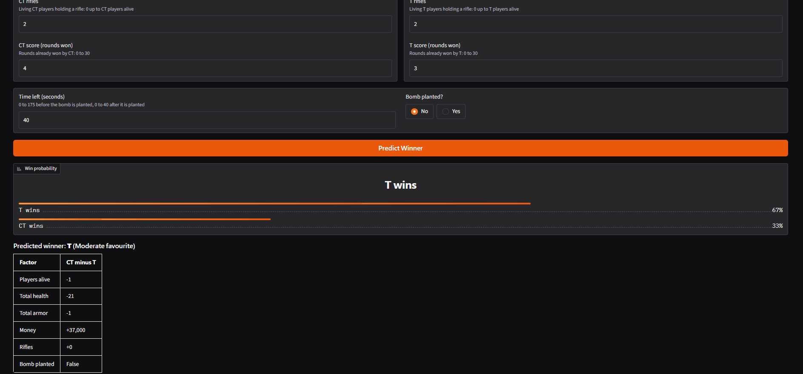
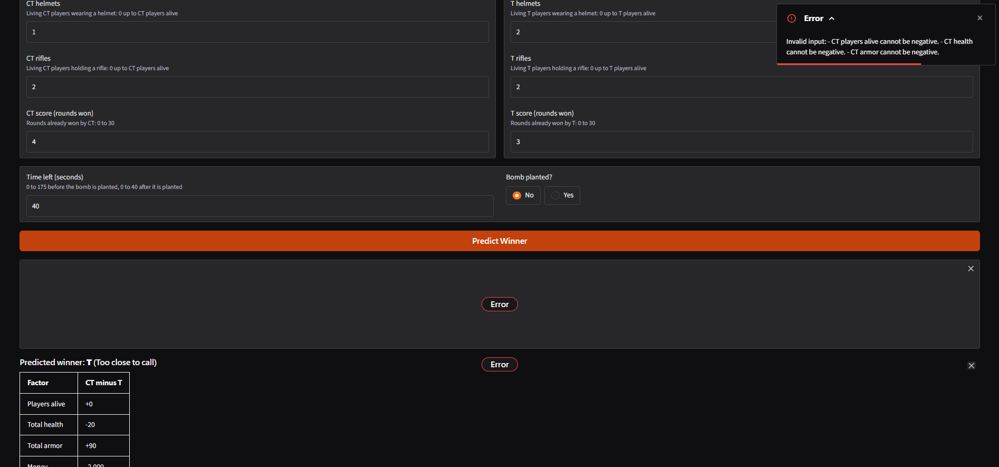

# CT or T? Predicting Who Wins the Round

Machine learning project that predicts the winner of a CS:GO round (CT or T) from a mid-round game snapshot, with an interactive Gradio app.

## Overview
- **Task:** binary classification (CT = 1, T = 0)
- **Dataset:** [CS:GO Round Winner Classification (Kaggle)](PASTE_KAGGLE_LINK_HERE), about 117,000 snapshots from roughly 23,500 rounds after cleaning
- **Best model:** tuned LightGBM using the top 15 features
- **Leakage prevention:** round IDs reconstructed from `time_left`, with GroupShuffleSplit and GroupKFold

## Results
| Metric | Value |
|---|---|
| Accuracy | 0.759 |
| AUC | 0.867 |
| Sensitivity (CT) | 0.794 |
| Specificity (T) | 0.727 |

Armor difference was the most important feature. Feature engineering and a weighted ensemble gave no meaningful AUC gain.

## Interactive App
The app takes a round snapshot, validates it (for example, negative values or impossible health and armor are rejected), and shows the CT and T win probabilities.

## How to Run
1. Download the dataset from Kaggle and open the notebook in Google Colab.
2. Upload `csgo_round_snapshots.csv` when asked and run all cells.
3. The last cells save the model and launch the Gradio app.

To run only the app, load `csgo_model.joblib` with `joblib` and use the prediction code from Part 5.

## Limitations
- Round IDs were reconstructed, not provided.
- The model is trained on real 5v5 match snapshots, so unusual inputs may give unreliable results.
- Early-round snapshots are inherently uncertain.

## Author
M A Nabihan Tasin

Built as a Machine Learning Lab project.
